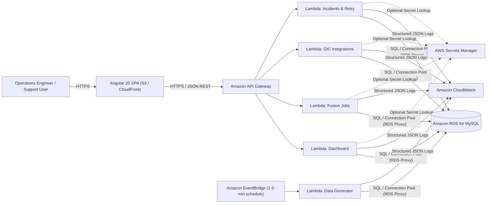
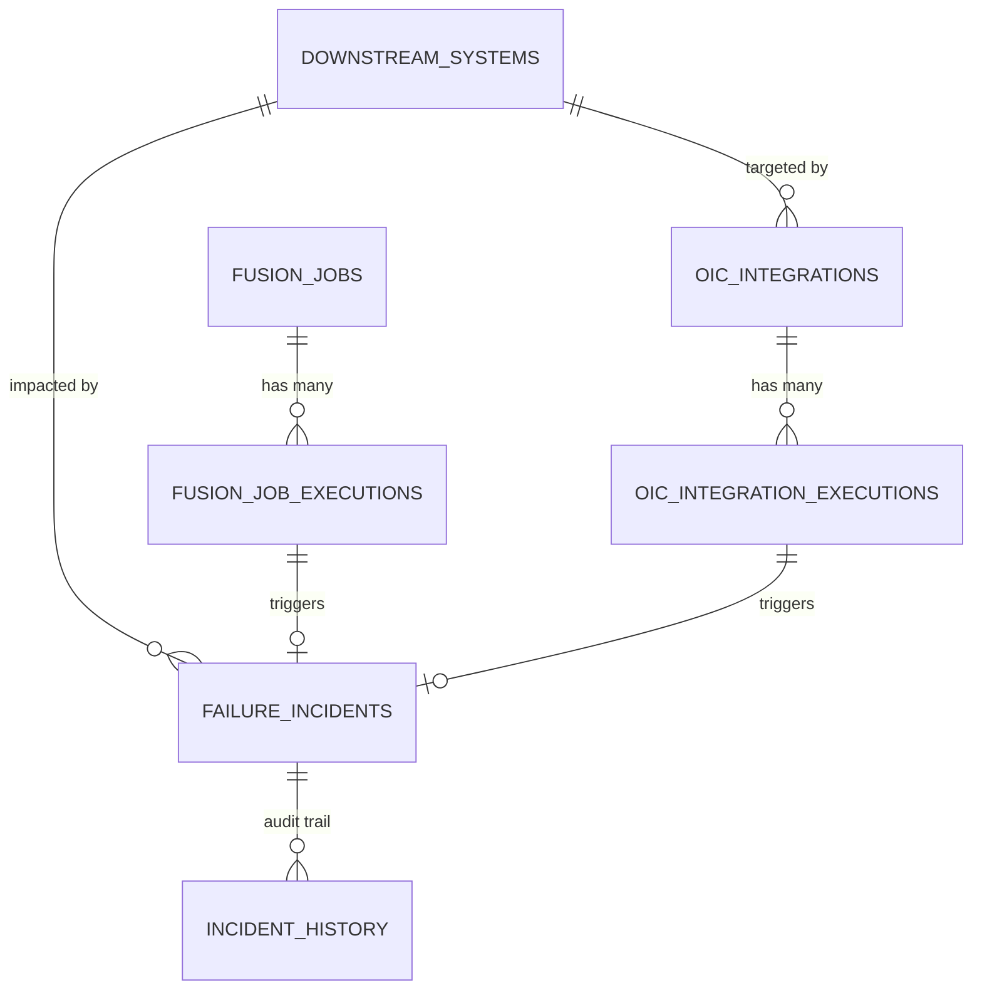
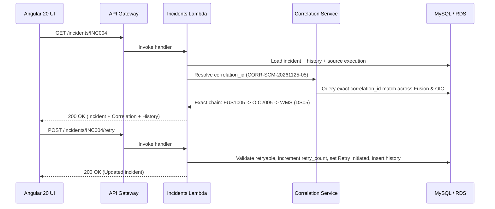

# Solution Architecture & Real Oracle Integration Migration Guide

## 1. Logical Architecture

## 2. Entity-Relationship Model

## 3. Correlation & Retry Simulation Flow

## 4. Replacing Simulated Feeds with Real Oracle Monitoring APIs

Because the Angular 20 UI and core REST APIs consume normalized domain models from MySQL via repository interfaces, replacing simulated data with live Oracle Cloud feeds requires **zero UI changes** and **zero changes to Dashboard/Incidents service boundaries**:

1. **Replace `DataGeneratorLambda` with an `OraclePollerLambda` (EventBridge every 1-5 mins):**
   - **Oracle Fusion Cloud ESS Jobs:** Poll Fusion REST API (`/fscmRestApi/resources/11.13.18.05/erpintegrations` or ESS `getESSExecutionDetails` SOAP/REST) using OAuth2 client credentials stored in **AWS Secrets Manager**.
   - **Oracle Integration Cloud (OIC):** Poll OIC Monitoring REST API (`/ic/api/integration/v1/monitoring/instances?q={status:'FAILED'}`) and fetch instance fault details (`/ic/api/integration/v1/monitoring/instances/{id}/error`).
2. **Upsert into MySQL:** Map Oracle ESS `requestId` -> `fusion_job_executions.execution_id` and OIC `id` -> `oic_integration_executions.instance_id`, preserving `correlation_id` from Oracle ECID (`ecid`) or custom business tracking headers.
3. **Real Retry Execution (Optional Phase 2):** Swap `incidentRepository.retryIncident()`'s simulation flag to call:
   - Fusion ESS `submitESSJobRequest` for Fusion incidents, or
   - OIC `POST /ic/api/integration/v1/monitoring/instances/{id}/resubmit` for OIC incidents.
4. **Production VPC & Connection Pooling:** Deploy Lambdas into private VPC subnets with **Amazon RDS Proxy** in front of RDS MySQL so bursty API Gateway traffic and scheduled pollers reuse pooled connections without exhausting `max_connections`.
